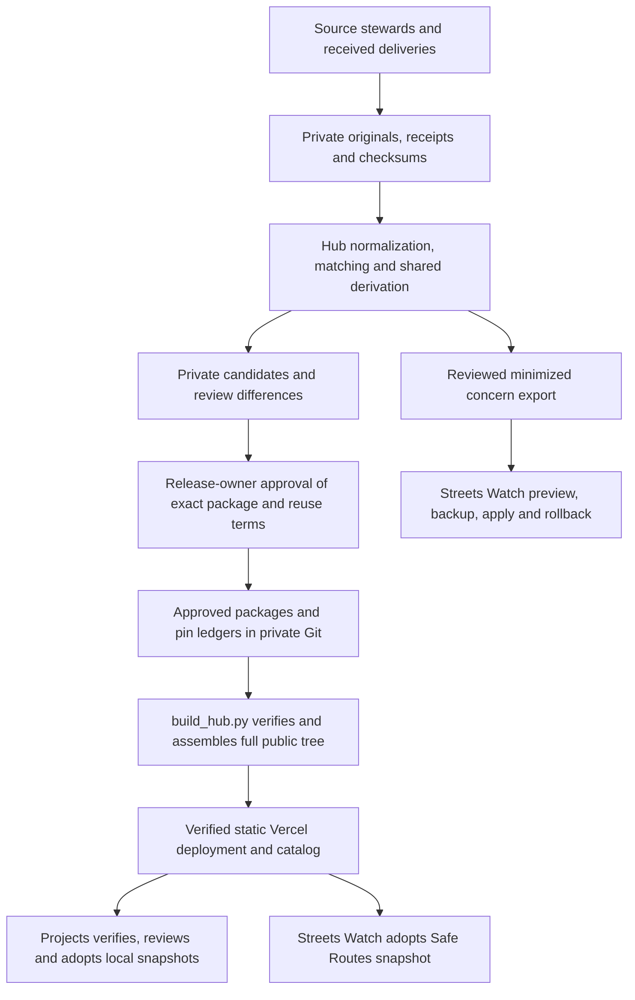

# BikeWalk Provo Data Hub system design

As-built review dated November 8, 2026, against hub implementation `ae24a9b`, closeout evidence `643a969`, and canonical Projects adoption `94827605a72eb1bee5e31b5ce4efd9e1a1f9b36e`. This document describes the maintained architecture. Deployment IDs, live adoption checks and migration closeout belong in [completion.md](completion.md) and the product release records. Update this document with improvements, enhancements and refactors under [AGENTS.md](AGENTS.md).

## System and trust boundaries

The private GitHub repository `bpj-repos/bikewalk-provo-data-hub` owns shared source interpretation and publishes approved, versioned files over HTTPS. Its Vercel project is `bikewalk-provo-data-hub` in `brycepjs-projects`. The mutable catalog lists available versions and manifest hashes. Consumers explicitly select a version, verify its bytes and keep local snapshots. All source intake and hub writes run through private maintainer tools. Projects and Streets Watch control their own adoption and application state. [Public catalog](https://bikewalk-provo-data-hub.vercel.app/catalog.json) · [Ownership contract](ownership.md)



Original crash workbooks, forwarded messages, detailed observations, matching evidence, review exports and recovery archives stay in access-controlled private storage. Local `private/`, `tools/.danger-zone-private/`, `tools/.danger-zone-data/`, environments and Vercel link state are ignored by Git. An ignore rule prevents accidental tracking through ordinary Git operations, while deployment safety comes from uploading only a separately assembled `public/` tree and `vercel.json`. Dataset-specific public-field validators and owner review govern disclosure. Concern exports travel through a restricted handoff to the importer and its backups. [Ignore rules](.gitignore) · [Private crash operations](crash-operations.md)

The source steward owns corrections at origin. The hub owns normalization, missingness, identities, shared measures, official subsets, public membership and withdrawal. Apps own annotations, concern membership, editorial additions and view filters. An app extension keys to source identity and release. Source-qualified station IDs are scoped to a year/layer. Crash source groups and reviewed links retain uncertainty and disagreement. An app reports a suspected shared-rule error for a corrected hub version. [Ownership contract](ownership.md)

## Products and acquisition

| Product and current public version | Input and maintained producer | Published scope and consumer |
|---|---|---|
| `annual-transportation-counts` 1.0.1 | `counts.py` reads checksummed CSV/JSON Git blobs at the source commit in `counts/sources.json`. `counts_candidate.py` accepts a receipt, unchanged delivery and reviewed normalized annual slice. | Series and per-year CSVs, dictionary, mapping, protocol and change notes. Known holdings cover 2019 and 2021–2026. Projects adopts 1.0.1. The 2026 all-mode and scooter totals are 6,186 and 283. |
| `safe-routes-to-school` 1.1.0 | `safe_routes.py receive` queries three UDOT ArcGIS layers and retains current plus July archive inputs. `prepare`, `review_routes.py`, `review_campus.py` and `audit_coverage.py` support review. | Three GeoJSON layers with source/campus provenance, dictionary and coverage. Archived approved features and the planned Treeside campus have explicit status. Projects uses 1.1.0. Streets Watch independently uses 1.0.0. |
| `annual-at-crash-aggregates` 1.0.0 | `update_crashes.py` maintains private inputs. `danger_zones.research_reports.crash_report` defines the population. `crash_packages.py` prepares the public package. | Annual CSV, dictionary and method. Distinct state crash IDs assigned to Provo with motor-vehicle and nonmotorist evidence. Mode lines overlap. Projects uses 1.0.0. |
| `annual-motor-vehicle-crashes-without-nonmotorists` 1.0.0 | Same city receipts and parser, then `danger_zones.motor_vehicle_candidate` and `crash_packages.py`. | Annual CSV, dictionary and method. Requires affirmative vehicle and participant evidence, with reviewed parked-vehicle rules. Unresolved cases are held privately. Projects uses 1.0.0. |
| `provo-active-transportation-fatal-crashes` 1.1.0 | `fatalities.py` reads a pinned managed release and the checksummed 2010–2017 portal archive. | 25 crash points and 26 deaths, occurrence month, mode and approximate coordinates. Projects uses 1.1.0. |
| `provo-active-transportation-incident-map` 1.0.0 | `incident_map.py` reads retained normalized/derived snapshots, reviewed feature selection and a pinned map manifest. `incident-map-contracts/historical-v1/` freezes definitions and reference captures. | Historical 2018–September 2026 extract with 1,195 mapped source groups and four unmapped groups. Prepared summaries preserve source differences. Projects uses 1.0.0, with production/browser verification in the migration record. |
| Reviewed concern details, export schema 2 | `danger_zones.concern_details` verifies a private release and exports allowlisted enrichment plus accepted PD references. | A separate restricted handoff with seven field groups and reviewed match bases. Streets Watch imported 30 crashes across seven concerns, including four PD references. |

Counts distinguish observed zero, missing, unresolved and historically unavailable measures. Combined/session totals and source-recorded breakdowns overlap. Historical timing and station correspondence limit comparisons. Version 1.0.0 preserves the original scooter total of 236, and 1.0.1 derives 283 from two observed sessions. Counts CC0 approval covers the defined product. Other products carry their own attribution and reuse terms. [Counts contract](contract.md) · [Counts decision](counts/REVIEW.md) · [Coverage](coverage.md)

Crash intake refreshes UDOT on a normal run, reuses it with `--offline`, and accepts city portal workbooks and PD deliveries on receipt. Source acquisition checks membership/paging and retained hashes. The updater preserves observations, input history, reviewed identities, conflicts and predecessor pointers. Matching policy lives under `tools/crash_pipeline/src/danger_zones/`, with the registry, catalogs, schemas and reference captures beside it. Report dates, occurrence dates, unknown values and approximate geocoding retain their distinct meanings. [Crash operations](crash-operations.md) · [Producer transfer](crash-shadow.md)

The two annual crash series currently cover 2018–2025 as full calendar years and provisional 2026. A recent event date describes the selected records' coverage. The historical map has a separate denominator and source pin. Its mapped groups can overlap in event identity across unreconciled sources, so official annual totals come from the annual package. Fatalities has its own historical extension and geographic selection. [Annual population](wave-6.md) · [Motor-only method](approved/annual-motor-vehicle-crashes-without-nonmotorists/1.0.0/method.txt) · [Fatalities](fatalities-release.md) · [Incident map](incident-map.md)

Transit, bike parking/lanes, counters and intersection captures remain research snapshots in canonical BikeWalk `docs/research/transportation-source-snapshots/`. Proposed research lives in `docs/research/TODO.md`. Each new processed hub product needs a defined population, provenance, reuse and disclosure decision, validation and consumer contract.

## Release, approval and hosting

`counts/approved-pin*.json` pins the two real counts baselines, while `pins.json` preserves the two synthetic predecessors. `releases.json` is the ordered approval and withdrawal ledger for additional packages in `approved/DATASET/VERSION/`. Each catalog release names `/datasets/DATASET/VERSION/datapackage.json` and its SHA-256. Each manifest binds resource names, byte sizes and SHA-256 hashes. Old published versions remain immutable and retrievable until a documented withdrawal. Corrections get a patch, compatible additions a minor version, and incompatible meaning, units or identity a major version. [Counts contract](contract.md) · [Ledger](releases.json)

The collection lead verifies delivery completeness and protocol/mapping. The hub maintainer builds and checks candidates. The release owner approves the exact manifest hash, public fields and reuse terms. Candidate tools produce private packages and differences. Promotion records that approval, copies the reviewed package into `approved/`, and appends its pin. Counts candidates retain a private row-level review. Synthetic future-release fixtures remain private. Consumer adoption follows separately. [Maintainer operations](OPERATIONS.md)

`build_hub.py` reconstructs both real counts releases and synthetic predecessors from pinned Git inputs, then adds approved packages. It verifies package identities, resource paths, sizes and hashes, rejects replacement pins and synthetic candidates, applies withdrawals and writes a new full tree. Dataset builders and tests enforce semantic contracts before approval. The assembler's checks protect approved bytes. It selects current versions by ledger order. Successful output is a new staging directory containing `public/` and `vercel.json`.

Vercel serves that static output. `vercel.json` sets wildcard CORS, CSV/GeoJSON MIME types, `nosniff`, and the historical map's `noindex, nofollow, noarchive` response. The public surface consists of catalog, manifest and resource GETs. Private tools perform every update. Existing Vercel team allowance and usage are shared with other projects. Review actual usage before promotion or expansion. [Host configuration](vercel.json) · [Hosting evidence](hosting.md)

From the hub root, using full source history and a fresh destination, the current restore command is

```sh
export BWP_SOURCE_REPO=/absolute/path/to/bikewalk-provo
python3 -B -m unittest
python3 -B build_hub.py "$BWP_SOURCE_REPO" /tmp/new-hub-stage
python3 -B check_public.py /tmp/new-hub-stage/public
```

The last command compares local files with the production alias. During a release, compare the staged deployment first with `check_public.py PUBLIC --stage STAGING_HTTPS_URL`. From the assembled staging directory, link to the existing project, run `vercel deploy --prod --skip-domain`, verify all files, hashes, MIME and CORS, then promote that exact deployment. Recheck the stable alias anonymously and record deployment ID, source commit and approved pins. The separate staged deployment permits validation before the stable alias changes. `release.py` and `verify_host.py` reproduce the historical synthetic proof. [Promotion procedure](OPERATIONS.md)

For withdrawal, append safe notice/date and dataset/version to `releases.json` and deploy a newly assembled tree. The builder removes that version's files and marks the catalog entry withdrawn, selecting a remaining release when available. The operator checks affected URLs return 404, reviews shared bytes across all versions, handles caches/old deployments and notifies known consumers to remove copies. Historical rollback must honor the current withdrawal list. Hashes detect byte changes. The reviewed repository and approval process establish which pin to trust. [Withdrawal and restore procedure](OPERATIONS.md)

## Scheduling and consumer adoption

`.github/workflows/safe-routes.yml` runs at `41 14 1 * *` UTC and supports manual dispatch. It downloads the pinned private July archive, receives provider layers, prepares a candidate and reviews campus/coverage changes. The private artifact has 30-day retention. Attempt/success files and run history distinguish an attempted check from success. Provider approval dates, retrieval times, source coverage and consumer adoption dates answer different freshness questions. Release review stays manual. Counts follows annual deliveries/corrections. Crash updates follow maintainer runs and received state/PD records. [Workflow](.github/workflows/safe-routes.yml) · [Maintenance](OPERATIONS.md)

The canonical consumer is `bpj-repos/bikewalk-provo`, currently at `/Users/test/Documents/ChatGPT/bikewalk-provo`, with Projects in `apps/maps`. Its `scripts/hub-update.py` supports six dataset aliases. From that application directory

```sh
python3 scripts/hub-update.py status
python3 scripts/hub-update.py stage incidents 1.0.0
python3 scripts/hub-update.py apply REVIEW_SHA256
npm test
npm run build
```

Stage verifies the catalog entry, manifest, resources and adapter expectations, then records a private review digest and differences. Apply rechecks the catalog, staged bytes and current snapshot under a local lock. Counts/crash datasets use retained version directories and an atomic `current` symlink switch. Safe Routes uses a directory swap with an interruption backup. Repeated adoption is a no-op. Current adapters accept stable 1.x versions. Routes staging uses hub `adopt_routes.py`, requires the reviewed producer commit for a new version and accepts `BWP_HUB_CHECKOUT` for a relocated hub checkout.

Projects builds from committed snapshots. Incident adoption writes the established `/data/demos/police-incidents/{incidents,manifest}.json` URLs after offline hash/field validation. The legacy local summary approval command refuses to overwrite a hub adoption. Projects owns filters, layout, camera and local editorial information keyed to state IDs. The build explicitly selects webpack. Consumer tests, browser checks, commit and deployment complete adoption. Rollback stages/applies a previously available pin or restores a verified complete application deployment, subject to withdrawals. Application instructions live in canonical `apps/maps/README.md`.

Streets Watch (`bpj-repos/streets.watch`) serves its adopted Safe Routes layers from `data/safe-routes-legacy/`. Hub `adopt_routes.py PREVIOUS_MANIFEST NEW_OUTPUT VERSION MANIFEST_SHA PRODUCER_COMMIT` prepares its compatibility snapshot. Concern imports use `scripts/import-concern-crash-details.ts` in preview/apply/rollback modes with the restricted export hash and backup hash. Existing state IDs determine lookup. Per-concern transactions check the current history and rollback protects intervening edits. Each consumer chooses its release independently. [Concern integration](https://github.com/bpj-repos/streets.watch/blob/main/docs/CONCERN_CRASH_DETAILS.md)

## Tests, recovery and laptop portability

The standard-library root suite covers synthetic release integrity, real counts parity/pins and Safe Routes acquisition and contracts. Set `BWP_SOURCE_REPO` to exercise the real counts cases. The crash suite is separate and requires Python 3.11+ with the exact dependencies in `tools/crash_pipeline/pyproject.toml`. Install an editable copy into a dedicated environment with `python -m pip install -e ./tools/crash_pipeline`, or use `PYTHONPATH=.:tools/crash_pipeline/src` with an existing matching environment. Node is also required for incident public-field validation. To run the producer suite from the hub root

```sh
PYTHONPATH=.:tools/crash_pipeline/src python -B -m unittest discover \
  -s tools/crash_pipeline/tests
```

Private-receipt tests can skip when holdings are unavailable. Record skips with results. The suite covers parsing, source matching, normalized/derived agreement, enrichment and public candidate checks. Recorded migration evidence includes 133 passing producer tests, two identical incident builds, corrupt-input rejection, 23 Projects JavaScript and three Python adoption tests. The closeout also records 24 passing real-data desktop/phone/tablet cases and production smoke checks. This documentation review separately ran all 16 root tests with real inputs, reconstructed 80 public files, and confirmed the six current versions and pins against the anonymous production catalog. Live migration/browser evidence is maintained in [completion.md](completion.md).

There are three recovery levels

| Recovery target | Retained material and procedure | Verified limit |
|---|---|---|
| Serve approved releases | Full hub and canonical BikeWalk Git histories, pinned counts blobs, `approved/` packages, ledgers and `build_hub.py`. | Clean-checkout and independent-agent builds have been exercised on this host. Ordinary assembly uses Python/Git and avoids crash-environment dependencies. |
| Rebuild Safe Routes from source | Private GitHub release `source-receipts-safe-routes-20261107`, checksummed assets and `safe_routes.py prepare`. | Authorized repository access is required. `OPERATIONS.md` lists exact asset hashes. The 30-day workflow artifact is temporary review output. |
| Replay crash intake and historical detailed products | Restricted crash recovery archives, inventory/verifier, current operational tree, receipts, policy and dependencies. `crash-operations.md` gives exact restore roots, manifest pins and rollback commands. `incident-map-contracts/historical-v1/receipt.json` supplies the source-free historical map recipe. | Independent-agent recovery used this machine and existing OS account. A clean clone at a different path reproduced all 14 map inputs, the package and full public tree. A separate human and off-machine recovery were explicitly deferred. The cutover archive needs supplementation for subsequent intake. |

Routine crash writes enter through `python update_crashes.py`, with `--offline`, `--portal-workbook`, `--police-input`, `--reviewed-matches` or `--rollback` as documented. The active pointer is under `private/crashes/operational-20261107/tools/.danger-zone-private/datastores/combined-incidents.json`. Update and rollback share a filesystem lock, verify predecessors and retain audit records. `review_crash_receipt.py` compares the new pin against both published annual packages and the concern export last adopted by Streets Watch. Keep failed candidates for diagnosis and retain the last verified pointer. [Crash operations](crash-operations.md)

The managed release records its producer commit and fingerprints inputs, matching policy and tools. `danger_zones.update_incidents.tool_hash` covers an explicit module list, three incident catalogs and `pyproject.toml`. The source registry YAML and reference captures require separate review because they sit outside that file list. Preserve the full checkout and retained evidence when reproducing a private release. [Fingerprint implementation](tools/crash_pipeline/src/danger_zones/update_incidents.py)

Portability currently needs operator work. `update_crashes.py` contains historical `/Users/test/...` origin mappings and selects a dated operational root. `review_crash_receipt.py` also selects that root. `fatalities.py` binds a retained historical workbook under the operational intake. Recovery uses the pipeline module's repeatable `--restore-path ORIGINAL_ROOT RESTORED_ROOT` plus explicit data roots to resolve immutable historical references. The pinned dependency list supplies reproducible versions, while setup still requires repository and archive access. Local `fcntl` locks coordinate processes sharing one filesystem. Administrators on separate laptops need an agreed writer/promotion owner to avoid divergent active state.

## Prioritized future improvements

These proposals follow the verified implementation above. Default to existing tools, static files and zero incremental service cost. Each item needs its own scoped change and evidence before adoption.

| Priority | Proposed improvement | Yield and concrete acceptance check |
|---|---|---|
| 1 | Retain a current off-machine crash backup in an owner-approved private location, with checksummed inventory, producer commit and access instructions. Extend the existing recovery runbook and rehearse with a second authorized admin/agent on another laptop. | Addresses the largest recovery dependency. Restore current intake, reviewed links and historical map inputs into a new path, reproduce approved pins offline, repeat a receipt and roll back. Verify permissions and backup retrieval as part of the drill. |
| 1 | Make the operational root explicit across `update_crashes.py`, `review_crash_receipt.py` and `fatalities.py`, reusing the existing restore-path machinery. Document one environment/bootstrap path and writer handoff. | Removes maintainer-home-path assumptions. Two arbitrary checkout locations should run the same offline fixture and select the same verified pin. Preserve original receipt paths and manifests as evidence. |
| 1 | Extend GitHub Actions to run appropriate hub tests and a deterministic public restore/check on changes. Add compact source/check/release status to the existing maintenance record and use workflow failure notifications. | Catches broken builds and missed checks before promotion. Exercise corruption, predecessor pins and withdrawals, report unavailable private fixtures, and retain approvals/evidence beyond the monthly artifact window. Reuse authorized inputs and review current Actions allowance first. |
| 1 | Review the complete producer dependency/configuration fingerprint, including source registry and reference captures used by parsing and derivation. Extend the existing fingerprint and focused regressions where needed. | Makes changed interpretation trigger re-evaluation on repeated input. Change a relevant definition or source configuration under a fixed receipt and verify the updater recomputes or rejects it, with an explicit review before public release. |
| 2 | Add concise consumer examples and a tested public download verifier using the current manifest/resource contract. Record known consumer contacts, adopted pins and withdrawal acknowledgments in a private register. | Helps spreadsheets, Python/R and GIS users adopt safely and helps operators reach adopters. A fresh consumer verifies a selected pin, reads a documented subset and rejects a corrupted resource. Explicitly state schema support, missingness, citation and source terms. |
| 2 | Add reviewed static subsets or compact encodings when consumer demand justifies them, generated from the same approved records with parity tests. | The incident package is about 17.3 MB, so 10,000 complete downloads are about 173 GB before overhead. Measure requests and transfer, then consider year/area subsets or a slim map resource. Evaluate Parquet for analytical consumers and XLSX for a requested workbook experience. Retain semantic versions, pins and disclosure review. |
| 2 | Strengthen approval records and promotion coordination as the admin group grows. Tie manifest hash, reviewer, producer commit, source receipt, deployment and consumer changes together in the existing Git/runbook process. | Makes a second agent's work reviewable and prevents competing promotions. Rehearse handoff and failure recovery with two admins while keeping one active private writer and a recorded stable deployment. |

Consider a hosted query endpoint only after concrete consumers need queries that versioned downloads and static subsets cannot serve economically. Any future service needs its own access, cost, disclosure, availability and recovery design. Current evidence supports further consumers through the existing file contract first.
