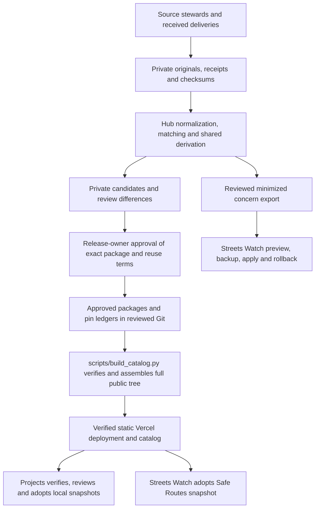

# BikeWalk Provo Data Hub system design

Reviewed November 11, 2026 against the Hub implementation, release ledger, public catalog and consumer repositories. The catalog listed eight datasets. The [migration closeout](history/hub-migration-completion.md) records the November 8 baseline and its verification. Update this document alongside changes to the system under [AGENTS.md](../AGENTS.md).

The November 8 filesystem migration groups human documentation in docs, commands in scripts, reusable processing code in pipelines, definitions in data-definitions, approved packages in releases and regressions in tests. The [repository guide](../README.md) and [command index](../scripts/README.md) are the navigation entry points. The public URL layout, definitions and approved package bytes reproduce the pre-migration baseline. Local active crash data now lives under private/active/crashes, with restricted historical aliases and separate intake, candidates, reviews, exports, backups and archives. See [the migration runbook](operations/layout-migration.md).

## System and trust boundaries

The GitHub repository `bpj-repos/bikewalk-provo-data-hub` owns shared source interpretation and publishes approved, versioned files over HTTPS. Its Vercel project is `bikewalk-provo-data-hub` in `brycepjs-projects`. The mutable catalog lists available versions and manifest hashes. Consumers explicitly select a version, verify its bytes and keep local snapshots. All source intake and hub writes run through private maintainer tools. Projects and Streets Watch control their own adoption and application state. [Public catalog](https://bikewalk-provo-data-hub.vercel.app/catalog.json) · [Ownership contract](ownership.md)



Original crash workbooks, forwarded messages, detailed observations, matching evidence, review exports and recovery archives stay in access-controlled private storage. Local `private/`, `build/`, configuration overrides, environments and Vercel link state are ignored by Git. An ignore rule prevents accidental tracking through ordinary Git operations, while deployment safety comes from uploading only a separately assembled `public/` tree and `vercel.json`. Dataset-specific public-field validators and owner review govern disclosure. Concern exports travel through a restricted handoff to the importer and its backups. [Ignore rules](../.gitignore) · [Private crash operations](operations/crash-updates-and-recovery.md)

The source steward owns corrections at origin. The hub owns normalization, missingness, identities, shared measures, official subsets, public membership and withdrawal. Apps own annotations, concern membership, editorial additions and view filters. An app extension keys to source identity and release. Source-qualified station IDs are scoped to a year/layer. Crash source groups and reviewed links retain uncertainty and disagreement. An app reports a suspected shared-rule error for a corrected hub version. [Ownership contract](ownership.md)

## Products and acquisition

| Product and version or export schema | Input and maintained producer | Published scope and consumer |
|---|---|---|
| `annual-transportation-counts` 1.0.1 | `scripts/build_counts_releases.py` reads checksummed CSV/JSON Git blobs at the source commit in `data-definitions/annual-transportation-counts/sources.json`. `scripts/prepare_counts_candidate.py` accepts a receipt, unchanged delivery and reviewed normalized annual slice. | Series and per-year CSVs, dictionary, mapping, protocol and change notes. Known holdings cover 2019 and 2021–2026. Projects adopts 1.0.1. The 2026 all-mode and scooter totals are 6,186 and 283. |
| `safe-routes-to-school` 1.3.0 | UDOT plan acquisition and campus review feed the three original layers. The hub matches retained local Brokenspoke/OSM and Utah Bikeways network snapshots to those routes, then packages two companion GeoJSON resources. | Streets Watch adopts the five map layers and provides an optional stress overlay. Its frozen compatibility API keeps its earlier three-layer pin. See [stress protocol](../data-definitions/safe-routes-to-school/stress-method.md) and [recovery](operations/bicycle-stress.md). |
| `annual-at-crash-aggregates` 1.1.0 | `scripts/update_crashes.py` maintains private inputs. `danger_zones.research_reports.crash_report` defines the population. `scripts/prepare_crash_releases.py` prepares the public package. | Annual CSV, dictionary and method. Distinct state crash IDs assigned to Provo with motor-vehicle and nonmotorist evidence. Mode lines overlap. Version 1.1.0 includes the historical archive and a second CSV covering 2018 onward. |
| `provo-bicycle-traffic-stress` 1.0.0 | The citywide producer reconciles street inventories and source-specific stress ratings. | Segment, approach and reference geometry with coverage and method. Streets Watch reviews its overlay against a selected release. [Producer and refresh](#citywide-bicycle-traffic-stress) |
| City annual crash aggregates, four datasets at 1.1.0 | City-filtered portal workbooks feed the shared annual calculation. The ledger selects the city versions for publication. | Springville, West Valley City, Salt Lake City and St. George each have a complete hosted ZIP. [City crash data](operations/city-crash-data.md) |
| Reviewed concern details, export schema 2 | `danger_zones.concern_details` verifies a private release and exports allowlisted enrichment plus accepted PD references. | A separate restricted handoff with seven field groups and reviewed match bases. Streets Watch imported 30 crashes across seven concerns, including four PD references. |

Counts distinguish observed zero, missing, unresolved and historically unavailable measures. Combined/session totals and source-recorded breakdowns overlap. Historical timing and station correspondence limit comparisons. Version 1.0.0 preserves the original scooter total of 236, and 1.0.1 derives 283 from two observed sessions. Counts CC0 approval covers the defined product. Other products carry their own attribution and reuse terms. [Counts contract](../data-definitions/annual-transportation-counts/contract.md) · [Counts decision](decisions/counts-publication-2026-11-07.md) · [Coverage](../data-definitions/safe-routes-to-school/coverage-1.0.0.md)

Crash intake refreshes UDOT on a normal run, reuses it with `--offline`, and accepts city portal workbooks and PD deliveries on receipt. Source acquisition checks membership/paging and retained hashes. The updater preserves observations, input history, reviewed identities, conflicts and predecessor pointers. Matching policy lives under `pipelines/crashes/src/danger_zones/`, with the registry, catalogs, schemas and reference captures beside it. Report dates, occurrence dates, unknown values and approximate geocoding retain their distinct meanings. [Crash operations](operations/crash-updates-and-recovery.md) · [Producer transfer](history/crash-producer-transfer.md)

For another Utah city, `scripts.prepare_city_crashes` reads a single checksummed city-filtered portal workbook directly into the shared annual nonmotorist calculation. It prepares a private aggregate package with a city-specific dataset ID. The source selection controls coverage, including selected years with zero qualifying crashes. The operator reviews full-year status. This path is independent of Provo's managed collection and needs no local police intake. The ordinary exact-pin promotion, withdrawal and adoption procedures apply per city. The workbook-only flow reproduced the published Provo 1.0.0 annual CSV byte for byte. A synthetic Orem workbook exercises the second-city path. [City preparation and review](operations/crash-updates-and-recovery.md#prepare-another-utah-citys-annual-crash-series)

City-history capture scripts retain checksummed portal workbooks, complete UDOT annual pedestrian/bicycle selections and municipal polygons privately. UDOT annual inventory discovery prefers hosted records for overlapping years and preserves the archive's earlier coverage. The offline report verifies intake receipts and counts distinct state IDs, tolerating only identical duplicate UDOT observations. Reviewed aggregate coverage and event dates live in `data-definitions/crashes/city-coverage.json` and drive the README table. Each listed city can have a separate annual-only package and ZIP registered by `scripts.register_city_crashes`. It verifies the exact candidate pin, uses the catalog builder's ZIP routine, preserves immutable versions, and updates the release ledger, coverage and relative repository link. The city builder uses the same annual calculation and package writer as Provo. Starting with city format 1.1.0, a series with pre-2018 coverage also includes Provo’s 2018-onward CSV shortcut. Registration verifies its bytes against the full series before linking the ZIP. Earlier city pins retain their original resources. A fresh clone rebuilt Springville from its checksummed workbook, reproduced its published annual CSV byte for byte, and registered the expanded ZIP and README link locally. This provides a contributor workflow independent of the canonical website checkout. The full catalog derives its hosted ZIP from the same manifest-listed bytes. Publication, withdrawal and consumer adoption follow the existing operations. [City contribution, methods and verification](operations/city-crash-data.md)

The non-motorist series begins in 2010 and the motor-only series begins in 2018. Both cover full years through 2025 and provisional 2026. A recent event date describes the selected records' coverage. The historical map has a separate denominator and source pin. Its mapped groups can overlap in event identity across unreconciled sources, so official annual totals come from the annual package. The standalone fatalities, motor-only and historical incident-map datasets are retired. Streets Watch serves the public crash and Safe Routes maps. Projects redirects its retired viewers there. The assembler preserves their published packages for pinned consumers and omits these datasets from the catalog through the release ledger’s retired list. [Annual population](history/annual-crash-migration.md) · [Motor-only method](../releases/datasets/annual-motor-vehicle-crashes-without-nonmotorists/1.0.0/method.txt) · [Fatalities](datasets/fatal-crashes.md) · [Incident map](datasets/historical-incident-map.md)

The hub normalizes six historical portal codes into the current enrichment fields. Portal source coverage spans cumulative receipts within each scope. The active collection includes 651 historical Provo observations. Its annual release provides the full series and a checksummed 2018-onward subset. [Historical backfill rules and verification](operations/crash-updates-and-recovery.md#historical-provo-portal-backfills)

Readable crash-map exports use the hub's `danger_zones.crash_labels.export_values` projection at importer build time. Supplied companion labels become base values and separate `_label` fields are omitted. Field-specific codebooks decode absent labels; unresolved numeric codes remain explicitly unmapped. Identifiers, counts, raw observations, normalized analytical code predicates and old published pins retain their meanings. `scripts.migrate_crash_map_labels` migrates an existing minimized Streets Watch snapshot into a checksummed candidate and can adopt it locally after verification, preserving old immutable versions and shared links. It changes section fields only, retains map membership/geometry/filter categories, and requires no credentials or private workbooks. The consumer serves the bundled version without a live hub dependency and accepts both old and new summary field names. [Export contract, limitations and recovery](datasets/crash-export-values.md)

Transit, bike parking/lanes, counters and intersection captures remain research snapshots in canonical BikeWalk `docs/research/transportation-source-snapshots/`. Proposed research lives in `docs/research/TODO.md`. Each new processed hub product needs a defined population, provenance, reuse and disclosure decision, validation and consumer contract.

## Release, approval and hosting

`releases/baseline-pins/counts-*.json` pins the two real counts baselines, while `releases/baseline-pins/demo-counts.json` preserves the two synthetic predecessors. `releases/release-ledger.json` is the ordered approval and withdrawal ledger for additional packages in `releases/datasets/DATASET/VERSION/`. Each catalog release names `/datasets/DATASET/VERSION/datapackage.json` and its SHA-256. Each manifest binds resource names, byte sizes and SHA-256 hashes. Old published versions remain immutable and retrievable until a documented withdrawal. Corrections get a patch, compatible additions a minor version, and incompatible meaning, units or identity a major version. [Counts contract](../data-definitions/annual-transportation-counts/contract.md) · [Ledger](../releases/release-ledger.json)

The collection lead verifies delivery completeness and protocol/mapping. The hub maintainer builds and checks candidates. The release owner approves the exact manifest hash, public fields and reuse terms. Candidate tools produce private packages and differences. Promotion records that approval, copies the reviewed package into `releases/datasets/`, and appends its pin. Counts candidates retain a private row-level review. Synthetic future-release fixtures remain private. Consumer adoption follows separately. [Maintainer operations](operations/maintainer-guide.md)

`scripts/build_catalog.py` reconstructs both real counts releases and synthetic predecessors from pinned Git inputs, then adds approved packages. It verifies package identities, resource paths, sizes and hashes, rejects replacement pins and synthetic candidates, applies withdrawals and writes a new full tree. Dataset builders and tests enforce semantic contracts before approval. The assembler's checks protect approved bytes. It selects current versions by ledger order. Successful output is a new staging directory containing `public/` and `vercel.json`.

Vercel serves that static output. `vercel.json` sets wildcard CORS, CSV/GeoJSON MIME types, `nosniff`, and the historical map's `noindex, nofollow, noarchive` response. The public surface consists of catalog, manifest, resource and complete ZIP downloads. Private tools perform every update. Existing Vercel team allowance and usage are shared with other projects. Review actual usage before promotion or expansion. [Host configuration](../config/vercel.json) · [Hosting evidence](history/static-hosting-proof.md)

From the hub root, using full source history and a fresh destination, the current restore command is

```sh
export BWP_SOURCE_REPO=/absolute/path/to/bikewalk-provo
python3 -B -m unittest discover -s tests/hub -t .
python3 -B -m scripts.build_catalog "$BWP_SOURCE_REPO" /tmp/new-hub-stage
python3 -B -m scripts.verify_public_catalog /tmp/new-hub-stage/public
```

The last command compares local files with the production alias. During a release, compare the staged deployment first with `scripts/verify_public_catalog.py PUBLIC --stage STAGING_HTTPS_URL`. From the assembled staging directory, link to the existing project, run `vercel deploy --prod --skip-domain`, verify all files, hashes, MIME and CORS, then promote that exact deployment. Recheck the stable alias anonymously and record deployment ID, source commit and approved pins. The separate staged deployment permits validation before the stable alias changes. `scripts/build_demo_counts.py` and `scripts/verify_demo_host.py` reproduce the historical synthetic proof. [Promotion procedure](operations/maintainer-guide.md)

For withdrawal, append safe notice/date and dataset/version to `releases/release-ledger.json` and deploy a newly assembled tree. The builder removes that version's files and marks the catalog entry withdrawn, selecting a remaining release when available. The operator checks affected URLs return 404, reviews shared bytes across all versions, handles caches/old deployments and notifies known consumers to remove copies. Historical rollback must honor the current withdrawal list. Hashes detect byte changes. The reviewed repository and approval process establish which pin to trust. [Withdrawal and restore procedure](operations/maintainer-guide.md)

## Complete dataset downloads

The catalog builder also creates a complete ZIP for each available release of every listed dataset at `/downloads/DATASET/VERSION/DATASET-VERSION.zip`. Each archive contains one `DATASET-VERSION/` directory with the exact approved `datapackage.json` and every manifest-listed resource, including data, field definitions, methods, sources, attribution and release notes where supplied. It rechecks resource paths, sizes and hashes before packaging. It never includes unlisted files or private source inputs. Fixed member ordering, timestamps, permissions and compression settings make repeated builds reproducible.

Each catalog release has a `download` object containing the archive's `path`, `bytes` and `sha256`. This additive convenience interface does not change dataset manifests, resource bytes, release versions or consumer pins. Individual resource URLs remain available to existing consumers. ZIP responses use `application/zip`, attachment disposition and the existing public CORS policy. Projects links to these Hub-hosted archives and needs no ZIP library or client-side assembly.

Complete downloads are part of the maintained update process. `scripts.publish_route_update` invokes the shared catalog builder, and the counts, crash and traffic-stress publication workflows assemble through `scripts.build_catalog`. Agents run those entry points; the ZIP contents are derived from each approved manifest rather than a manually maintained archive/file list. A new-release regression adds a supporting detail resource, runs the normal catalog build and verifies its generated ZIP includes the new file while excluding an unlisted private file. The November 11 update-process verification passed all 44 Hub tests and 142 crash tests, with the retained-private-map-receipt fixture skipped in the isolated checkout.

Withdrawn releases and retired catalog entries receive no ZIP in a fresh build. Withdrawal verification must check both resource and archive URLs and honor the current ledger during rollback. The public verifier compares every archive byte with the reviewed build and checks download headers; protected-stage requests use the output directory's Vercel link independently of the caller's checkout. Archive regressions cover single-directory completeness, exact extracted bytes, repeatability, unsafe paths, corruption, catalog checksums, withdrawal and retirement.

## Scheduling and consumer adoption

The macOS LaunchAgent org.bikewalkprovo.safe-routes invokes scripts.monthly_route_review at 7:41 a.m. Mountain on the first of each month. A private external guard requires a clean main checkout. The runner locks the local filesystem, receives current providers using the retained checksummed July archive, prepares a private candidate and independently rebuilds it. Dated logs and review summaries remain under private/candidates. The GitHub review workflow has been retired. Counts follows annual deliveries/corrections and crash updates follow maintainer runs. [Scheduling and recovery](operations/bicycle-stress.md)

Public contributor CI runs both test groups and builds and validates synthetic counts on pull requests. A separate Python 3.11 job tests city mapping with the lightweight city dependencies. Both jobs use read-only permissions, disable credential persistence at checkout and publish no private artifacts. Retained-input skips are visible. Original code and documentation carry MIT terms, while datasets and third-party captures keep their source-specific terms. GitHub enforces a PR review and code-owner approval on main, dismissing stale approvals. Its sole always-bypass actor is the owner @brycepj, who retains direct-push rights and can merge the owner's PRs without approval. CODEOWNERS names that owner for every path. The publisher prepares release bytes for review and promotes only an exact package already recorded on current main. It writes local checksummed backups rather than uploading private receipt assets to GitHub. Publication and consumer adoption remain explicit maintainer actions. [Contribution and reuse](../CONTRIBUTING.md) · [Readiness review](operations/public-readiness.md)

BikeWalk Projects lives in `apps/maps` in `bpj-repos/bikewalk-provo`. Its updater supports the `counts` and `at-crashes` aliases. From that application directory, review a selected annual crash release with

```sh
python3 scripts/hub-update.py status
python3 scripts/hub-update.py stage at-crashes 1.1.0
python3 scripts/hub-update.py apply REVIEW_SHA256
npm test
npm run build
```

Projects independently adopts counts and annual crash chart releases. Its historical incident demo and Safe Routes viewer are retired. Old `/safe-routes`, `/maps/safe-routes`, `/maps` and `/demos/police-incidents` URLs redirect to Provo Streets Watch. Projects retains Safe Routes package metadata for the Data Hub download listing, without hosting map layers or running map adoption.

Streets Watch (`bpj-repos/streets.watch`) owns the public Safe Routes map, its approved five-layer snapshot in `public/data/safe-routes/`, presentation, field validation and `scripts/safe-routes-update.mjs`. Stage checks the public catalog and manifest/resource hashes, records a review digest and feature changes; apply rechecks withdrawal status, staged bytes and current snapshot, preserves a verified backup and swaps the directory. The weekly `safe-routes.yml` workflow prepares a review artifact for an approved newer Hub release using read-only repository permissions. A maintainer applies the reviewed digest locally and opens the normal PR. It never changes a branch or publishes automatically. The separate frozen `/api/safe-routes` adapter stays pinned in `data/safe-routes-legacy/`. App deployment and rollback follow Streets Watch's PR workflow and `docs/SAFE_ROUTES.md`. No private repository credentials or source records are needed by the consumer.

The Hub owns monthly refresh, modeling, receipts and immutable publication. The publisher rebuilds the reviewed candidate and retains local checksummed backups. Release preparation records the package and ledger for review. Promotion requires that exact package on current main and verifies the staged catalog before promoting the Hub deployment. It never changes or deploys Projects or Streets Watch. Its `--projects` path remains the counts source needed to assemble the catalog, not a map deployment target. The legacy `adopt_routes.py` entry point is retained only for historical consumer recovery; maintained adoption is self-contained in Streets Watch.

Concern imports use `scripts/import-concern-crash-details.ts` in preview/apply/rollback modes with the restricted export hash and backup hash. Existing state IDs determine lookup. Per-concern transactions check current history and rollback protects intervening edits. [Concern integration](https://github.com/bpj-repos/streets.watch/blob/main/docs/CONCERN_CRASH_DETAILS.md)

## Tests, recovery and laptop portability

The standard-library root suite covers synthetic release integrity, real counts parity/pins and Safe Routes acquisition and contracts. Set `BWP_SOURCE_REPO` to exercise the real counts cases. The crash suite is separate and requires Python 3.11+ with the exact dependencies in `pipelines/crashes/pyproject.toml`. Install an editable copy into a dedicated environment with `python -m pip install -e ./pipelines/crashes`, or use `PYTHONPATH=.:pipelines/crashes/src` with an existing matching environment. Node is also required for incident public-field validation. To run the producer suite from the hub root

```sh
PYTHONPATH=.:pipelines/crashes/src python -B -m unittest discover \
  -s tests/crashes -t .
```

Private-receipt tests can skip when holdings are unavailable. Record skips with results. The suite covers parsing, source matching, normalized/derived agreement, enrichment and public candidate checks. Recorded migration evidence includes 133 passing producer tests, two identical incident builds, corrupt-input rejection, 23 Projects JavaScript and three Python adoption tests. The closeout also records 24 passing real-data desktop/phone/tablet cases and production smoke checks. The November 8 review ran all 16 root tests with real inputs, reconstructed 80 public files, and confirmed the six current versions and pins against the anonymous production catalog. Live migration/browser evidence is maintained in [completion.md](history/hub-migration-completion.md).

There are three recovery levels

| Recovery target | Retained material and procedure | Verified limit |
|---|---|---|
| Serve approved releases | Full hub and canonical BikeWalk Git histories, pinned counts blobs, `releases/datasets/` packages, ledgers and `scripts/build_catalog.py`. | Clean-checkout and independent-agent builds have been exercised on this host. Ordinary assembly uses Python/Git and avoids crash-environment dependencies. |
| Rebuild Safe Routes from source | Local private/backups/github/source-receipts-safe-routes-20261107/, checksummed archives and `scripts/safe_routes.py prepare`. | Authorized private-workspace access is required. The maintainer guide lists archive hashes. At public launch, the original release assets remained in unpublished drafts and the historical Actions artifacts were removed after verified local retention. A same-disk restore has been verified. Independent backup coverage remains unverified. |
| Replay crash intake and historical detailed products | Restricted crash recovery archives, inventory/verifier, current operational tree, receipts, policy and dependencies. [Crash recovery](operations/crash-updates-and-recovery.md) gives exact restore roots, manifest pins and rollback commands. `data-definitions/historical-incident-map/historical-v1/receipt.json` supplies the source-free historical map recipe. | Independent-agent recovery used this machine and existing OS account. A clean clone at a different path reproduced all 14 map inputs, the package and full public tree. A separate human and off-machine recovery were explicitly deferred. The cutover archive needs supplementation for subsequent intake. |

Routine crash writes enter through `python -m scripts.update_crashes`, with `--offline`, `--portal-workbook`, `--police-input`, `--reviewed-matches` or `--rollback` as documented. The active pointer is under `private/active/crashes/collection/datastores/combined-incidents.json`. Update and rollback share a filesystem lock, verify predecessors and retain audit records. `scripts/review_crash_receipt.py` compares the new pin against both published annual packages and the concern export last adopted by Streets Watch. Keep failed candidates for diagnosis and retain the last verified pointer. [Crash operations](operations/crash-updates-and-recovery.md)

The managed release records its producer commit and fingerprints inputs, matching policy and tools. `danger_zones.update_incidents.tool_hash` covers an explicit module list, three incident catalogs and `pyproject.toml`. The source registry YAML and reference captures require separate review because they sit outside that file list. Preserve the full checkout and retained evidence when reproducing a private release. [Fingerprint implementation](../pipelines/crashes/src/danger_zones/update_incidents.py)

Portability currently needs operator work. The maintained updater and receipt reviewer select stable workspace locations through danger_zones.config. Ignored config/paths.local.json can override the defaults. Historical origins and their relative destinations are retained in private/active/crashes/path-map.json, backed up with the workspace. Recovery uses the pipeline module's repeatable `--restore-path ORIGINAL_ROOT RESTORED_ROOT`, optional `--restore-root WORKSPACE`, and explicit data roots to resolve immutable historical references. The pinned dependency list supplies reproducible versions, while setup still requires repository and archive access. Local `fcntl` locks coordinate processes sharing one filesystem. Administrators on separate laptops need an agreed writer/promotion owner to avoid divergent active state.

## Safe Routes source refresh

The local monthly or manually invoked runner acquires the upstream datasets and current Brokenspoke image into a private run. The local monthly runner drives acquisition, candidate preparation and independent rebuild. Actual model inputs, comparison vintage, new source digests, regional fallback calibration evidence and native values are tied to the candidate. Separate private diagnostics identify unrated geometry worth checking. Receipt-based rebuilds use seven decimal places for new derived line/point coordinates to make hashes portable across supported projection builds. Historical published bytes remain immutable. A successful review retains evidence in a dated private directory. The candidate path and manifest pin identify release preparation and Hub promotion after owner review, with checkpoints and local checksummed backups. See [operations](operations/bicycle-stress.md).

## Citywide bicycle traffic stress

The separate `provo-bicycle-traffic-stress` producer captures complete Provo and SGID street inventories and verifies checksummed retained OSM, published PFB, local Brokenspoke and Utah Bikeways inputs. `pipelines/traffic_stress` owns eligibility, shared-node topology, directional matching, deterministic precedence and native disagreements. It reuses route-stress projections and geometry helpers. Every applicable conflict selects one observation, with PFB winning equal or mixed published evidence. Local Brokenspoke fills gaps. Utah asymmetric scores remain whole-line observations. A tested original Furth Table 6 evaluator requires complete movement evidence; the first source-only pilot applies no unsupported Furth ratings.

The public package contains segment and approach GeoJSON, supplemental geometry, published reference linework, boundary, source register, coverage, dictionary and method. Private raw street inventories retain source attributes and model receipts. Five-meter matching introduces boundary approximation; supplemental overlap is a screening measure. Physical reference length and direction-length have different denominators. Degree-three OSM nodes define reference approach eligibility. Published BNA source junctions and unmatched rated line portions retain separate source_network selections and separately reported coverage; additional local inventory has unspecified direction until topology/access can be corroborated. The initial pilot has no independent field/rider validation or local-attribute model injection.

Manual capture and prepare commands create private candidates. Rebuild/hash checks, both test groups, exact release review, immutable ledger/catalog promotion, withdrawal and recovery follow existing hub operations. Streets Watch independently verifies a pin, reproduces its published-reference overlay and reviews combined changes. Its importer owns speed/lane filtering and node display deduplication. Adoption preserves crash details, immutable shared views and offline runtime. See [maintenance](operations/traffic-stress.md).

### Citywide dependency refresh

`scripts.refresh_traffic_stress` orchestrates current PFB metadata/ways, Geofabrik PBF, the Provo boundary and complete city/SGID/Utah Bikeways envelope captures. It accepts a retained verified receipt for dated intersection inventories and approved model settings. Provider edit stamps permit reuse only for the same source URL and extent with verified bytes. Missing edit stamps require recapture. Optional intersection refresh acquires all three public inventory layers. The citywide extent is independent of the school-route extent.

`pipelines.traffic_stress.refresh` extracts complete OSM ways using osmium in the approved image, parses only reference highway geometry/tags and retains shared node identities. It rejects missing way nodes. Immutable cache entries bind extraction to PBF/boundary/image/tool hashes, and model output to those data plus database digest, speed and model/runner tool hashes. Each recipe has a filesystem lock. Interrupted production never writes a cache receipt. Cache-hit bytes are verified, and corruption stops processing. The existing Safe Routes model runner owns UUID-scoped container/database cleanup.

Acquisition checkpoints, immutable canonical receipts and private review reports distinguish source acquisition, processing, candidate preparation and publication. Resume rejects changed inputs, baseline, version or tools and verifies existing package bytes. Reviews compare coverage and native selections while exposing identity/geometry churn. A new upstream analyzer is reported for deliberate adoption; routine data refresh retains the approved digest. Source failure leaves approved public pins available. These manual commands add no independent schedule and perform no automatic public/consumer promotion. The operations guide documents bootstrap from the private archive, recovery from partial acquisition/processing and exact-pin review.

November 10 verification includes a cold live acquisition/extraction/model run, verified cache reuse, unchanged resume pin, byte-identical independent rebuild of all 11 package files, 40 hub tests and 143 crash tests. Optional intersection acquisition has unit coverage but has not been run against the live endpoints. Refresh candidates remain private; the public 1.0.0 package and consumer pin remain unchanged. See the operations guide for the retained verification runs and their limits.

## City crash publication and mapping

City ZIP registration updates the repository table. To host a city version publicly, add its approved dataset ID and version to `publicCityReleases` in the release ledger, assemble the catalog and verify the staged and promoted downloads. Projects links the four published 1.1.0 city ZIPs in a collapsed section of its [Data Hub catalog](https://projects.bikewalkprovo.org/data-hub#utah-city-crashes).

The README city table uses the release ledger’s publicCityReleases selection for city-prefixed download links and excludes withdrawn versions. Provo uses its original approved, non-withdrawn annual-at-crash-aggregates product, whose ID predates the city-prefixed products. Coverage counts describe source captures and can be newer than a linked release. Generated annual summaries outside that selection retain their coverage rows with “Not yet available.” Both city registration and capture-history reporting use the same renderer, so refreshing coverage cannot reintroduce summary-only links.

### Portable city crash mapping

The city workbook reader in danger_zones.city_history validates source hashes, exact table headers, unrestricted filters, city/date/year selection and state crash identities. The annual producer and new city point exporter share it and the existing crash_modes rule. danger_zones.city_map projects one minimized feature per qualifying state crash, preserving source-qualified identity, local event date, crash severity and mode flags. Coordinates use WGS 84 longitude/latitude rounded to four decimals. Missing and invalid coordinates are counted rather than invented. The annual population includes qualifying records without map positions.

scripts.export_city_crashes writes a fresh private candidate with GeoJSON, dictionary, method and manifest and derives the complete ZIP through the maintained catalog ZIP builder. It does not register or publish a release. scripts.demo_city_crashes generates a synthetic city workbook and invokes that same path offline. QGIS and MapLibre instructions are in the city mapping guide. The point contract records source-specific rights and disclosure limits.

City preparation, export, demo, registration and history commands expose --json results with input/output paths, hashes, coverage, exclusions and a following command when available. Validation failures return structured errors and a nonzero exit. Existing human command output remains available. Registration retains its atomic writes, lock and immutable-pin checks.

requirements-city.txt installs openpyxl, defusedxml, jsonschema and PyYAML, plus timezone data on Windows. Catalog validation and date parsing keep their shared implementations. Source inventory imports pyarrow and its adapters only when invoked; geodesic reconciliation and UDOT geometry reporting similarly defer their GIS dependencies. Full producer dependencies remain pinned in pyproject.toml. The existing crash updater fingerprints changed source modules and can require re-evaluation on its next receipt. This change does not update active private pointers or published dataset bytes.

## Public source launch, November 11, 2026

The Hub Git repository is publicly readable and forkable. Branch/code-owner review restricts other contributors while @brycepj retains direct-push and unrestricted merge rights. Existing private source archives remain in four unpublished GitHub draft releases; anonymous release/asset checks verified they are hidden. Seven historical private Actions runs/artifacts were removed after verified local retention, as the owner requested. Secret scanning, push protection, dependency alerts and private vulnerability reporting are enabled. Raw private workspaces remain ignored. Upstream reference material retains its original terms and falls outside the MIT grant for original code/documentation. The readiness record preserves verification limits.

## Prioritized future improvements

These proposals follow the verified implementation above. Default to existing tools, static files and zero incremental service cost. Each item needs its own scoped change and evidence before adoption.

| Priority | Proposed improvement | Yield and concrete acceptance check |
|---|---|---|
| 1 | Retain a current off-machine crash backup in an owner-approved private location, with checksummed inventory, producer commit and access instructions. Extend the existing recovery runbook and rehearse with a second authorized admin/agent on another laptop. | Addresses the largest recovery dependency. Restore current intake, reviewed links and historical map inputs into a new path, reproduce approved pins offline, repeat a receipt and roll back. Verify permissions and backup retrieval as part of the drill. |
| 1 | Finish the cross-laptop bootstrap and access rehearsal using the stable operational roots and explicit path mappings implemented in the filesystem migration. Document writer handoff between administrators. | Removes maintainer-home-path assumptions. Two arbitrary checkout locations should run the same offline fixture and select the same verified pin. Preserve original receipt paths and manifests as evidence. |
| 1 | Extend the existing contributor checks with a deterministic full catalog restore where authorized inputs are available. Add compact source/check/release status to the existing maintenance record and use workflow failure notifications. | Catches broken builds and missed checks before promotion. Exercise corruption, predecessor pins and withdrawals, report unavailable private fixtures, and retain approvals/evidence beyond the monthly artifact window. Reuse authorized inputs and review current Actions allowance first. |
| 1 | Review the complete producer dependency/configuration fingerprint, including source registry and reference captures used by parsing and derivation. Extend the existing fingerprint and focused regressions where needed. | Makes changed interpretation trigger re-evaluation on repeated input. Change a relevant definition or source configuration under a fixed receipt and verify the updater recomputes or rejects it, with an explicit review before public release. |
| 2 | Add concise consumer examples and a tested public download verifier using the current manifest/resource contract. Record known consumer contacts, adopted pins and withdrawal acknowledgments in a private register. | Helps spreadsheets, Python/R and GIS users adopt safely and helps operators reach adopters. A fresh consumer verifies a selected pin, reads a documented subset and rejects a corrupted resource. Explicitly state schema support, missingness, citation and source terms. |
| 2 | Add reviewed static subsets or compact encodings when consumer demand justifies them, generated from the same approved records with parity tests. | The incident package is about 17.3 MB, so 10,000 complete downloads are about 173 GB before overhead. Measure requests and transfer, then consider year/area subsets or a slim map resource. Evaluate Parquet for analytical consumers and XLSX for a requested workbook experience. Retain semantic versions, pins and disclosure review. |
| 2 | Strengthen approval records and promotion coordination as the admin group grows. Tie manifest hash, reviewer, producer commit, source receipt, deployment and consumer changes together in the existing Git/runbook process. | Makes a second agent's work reviewable and prevents competing promotions. Rehearse handoff and failure recovery with two admins while keeping one active private writer and a recorded stable deployment. |

Consider a hosted query endpoint only after concrete consumers need queries that versioned downloads and static subsets cannot serve economically. Any future service needs its own access, cost, disclosure, availability and recovery design. Current evidence supports further consumers through the existing file contract first.

### Agent workflow review, November 8, 2026

Review of recent Bikeways acquisition, incident-map migration/recovery, crash-receipt comparison and Projects adoption found repeated work in locating the correct artifact, following provenance, assembling arguments and determining which checks remain. The following proposed tools would make those steps explicit and reproducible. Their names describe future entry points.

| Priority | Repeated agent decision | Proposed automation and existing foundation |
|---|---|---|
| 1 | Which repository, dataset copy and command apply? | A `hub_status.py locate DATASET --role ROLE` command resolves research capture, operational collection, approved release or consumer adoption. Return verified paths, pins, coverage, supported commands and missing prerequisites from existing registries and pointers. Keep machine-specific roots configurable and derive hashes from authoritative files. |
| 1 | How do I acquire, inspect and preserve a complete source? | A maintained `capture_source.py` with capture, inspect and resume operations produces raw responses, request parameters, completeness checks, field profiles and a checksummed receipt. Reuse `arcgis.fetch_layer`, snapshot-manifest helpers and `field_inventory.profile_field`. Resume only pages whose request identity and bytes verify. Make scope explicit. The existing `pipeline.import_ugrc_bikeways_lts` filters to the Provo city label and normalizes data, while the recent research capture retained statewide source responses. |
| 1 | Which baseline export and outstanding cases belong to this delivery review? | Extend `scripts/review_crash_receipt.py` to consume a recorded consumer-adoption receipt containing the exact previous export, hash and watchlist. Reuse its existing annual-package and concern comparison. Missing or stale baselines become explicit blockers. |
| 2 | Which source records and rules explain this crash or displayed value? | Extend `query_incidents.py` with exact source-qualified ID lookup and explanation output. Follow retained observations, accepted match evidence, definitions and release references. Include recorded product membership or exclusion reasons where available. |
| 2 | Which release checks remain before completion? | Persist a release-verification report tied to exact commits and manifest pins. Reuse `scripts/build_catalog.py`, `scripts/verify_public_catalog.py` and consumer checks. Record each required check as passed, failed, skipped or pending with its evidence location. Include predecessor preservation and withdrawal checks. |
| 2 | Which archive, recipe and path mappings reproduce this product? | A maintained recovery command verifies the archive, restores into a fresh directory, resolves historical paths, rebuilds and compares the expected package. Reuse existing restore-path handling, inventories and the tracked historical map recipe. Return a recovery report with unresolved prerequisites. |

Discovery, source capture/profiling and review-baseline resolution are the first implementation candidates. Several required primitives already exist. The hub registry names a Bikeways importer and `pipeline.py` implements it, while `pyproject.toml` currently installs only the crash updater entry point. A command index should report actual callable capabilities and scope. Research receipts should carry a source identity that allows discovery alongside operational manifests.

Use Projects' `hub-update.py` staging behavior as the interaction pattern. It verifies inputs, records a review digest and prints the exact apply command. Maintained hub commands should return structured `inputs`, `outputs`, `checks`, `blockers` and `nextCommand` fields, with command arguments represented as an array. Each operation revalidates referenced pins and current state before writing. These outputs can remove repeated argument construction and interpretation of prose logs. New definitions, disclosure decisions and disputed matches remain explicit review decisions supported by evidence.

These proposals came from the November 8 workflow review. City commands now provide structured results for city-specific workflows. The cross-dataset tools proposed above still need implementation and benchmarking.
